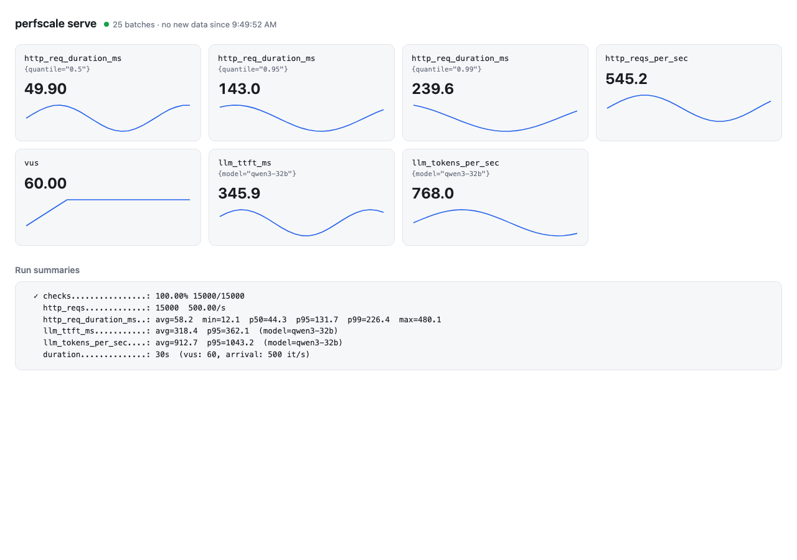

# CLI commands

```text
perfscale run          Run a load test with k6, locust, JMeter, or the native step engine
perfscale serve        Start a local dev server that receives metrics from `run --report`
perfscale lint         Validate test/config YAML files without running them
perfscale install      Fetch remote libraries and pin them in perfscale.lock
perfscale burn         Build a standalone binary with WASM libraries embedded
perfscale schema       Print the JSON Schema for test or config YAML files
perfscale metrics      List every metric the registered families declare
perfscale man          Print the bundled man page (or install it for `man perfscale`)
perfscale self-update  Update perfscale to the latest release for this platform
perfscale cache        Manage the local import/library cache (~/.cache/perfscale)
```

## `perfscale run`

Exactly one engine flag is required: `--k6`, `--locust`, `--jmeter`, or `-f`.

| Flag | Value | Description |
|---|---|---|
| `--k6 <FILE>` | `.js` script | Run via the `k6` binary on `PATH` |
| `--locust <FILE>` | locustfile | Run via the `locust` binary on `PATH`, headless |
| `--jmeter <FILE>` | `.jmx` test plan | Run via the `jmeter` binary on `PATH`, non-GUI (`jmeter -n -t`). The plan owns the load shape — no perfscale config applies |
| `-f, --file <FILE>` | `test.yaml` | Run with the built-in native engine (requires `-c`) |
| `-c, --config <FILE>` | `config.yaml` | Load config: `vus`, `duration`, optional `report.url`. Required with `-f`, optional load hint for `--locust`, ignored by `--k6` and `--jmeter` |
| `--host <URL>` | base URL | Target host for `--locust` (locust's `--host`) |
| `--report <SPEC>` | repeatable | Two shapes. `http(s)://URL` — POST the summary (and the report@v1 artifact, when reporters are configured) to a `perfscale serve` instance; overrides `report.url`. `json:PATH` / `junit:PATH` / `html:PATH` — write an end-of-run `report@v1` report: canonical JSON, JUnit XML for CI (testcase per step, failures from threshold verdicts), or a self-contained dark-themed HTML page (opens offline, archives as a CI artifact). Repeat the flag for several reports from one run |
| `--label <KEY=VALUE>` | repeatable | Run label stamped on the report's run identity (`run.labels`), e.g. `--label testid=smoke` |
| `-q, --quiet` | — | Suppress per-request output; errors and the final metric summary still print. The native engine drops the lines at the source, which also removes their formatting/IO cost under high load |
| `--summary-export <FILE>` | path, repeatable | After the run, write the parsed metric summary (requests, RPS, latency percentiles, error rate) plus run metadata (engine, VUs, duration, timestamp, perfscale version) to this file. Repeat the flag to write several exports from one run. A `.md`/`.json` extension picks the format per file (default JSON) |
| `--summary-format <json\|md>` | with `--summary-export` | Format for export files without a recognized extension. `md` renders a table for CI job summaries: `--summary-export "$GITHUB_STEP_SUMMARY" --summary-format md` |
| `--allow-remote-import` | — | Let `import:` in `-f`/`-c` documents fetch over the network (http(s) URLs, git remotes). Fail-closed by default — a document cannot grant itself network access. See [imports](../core/imports.md) |
| `--refresh-imports` | — | Refetch cached tag/branch git imports instead of trusting the cache (commit-SHA imports are immutable and never refetch) |

### End-of-run reports (`report@v1`)

`--report json:PATH` / `--report junit:PATH` / `--report html:PATH` (or the config's
`report.reporters` block, see the [YAML reference](../yaml-reference.md#config--c-configyaml))
write a canonical `report@v1` document after the run: `schemaVersion`, run
identity (engine-generated `run_id` plus `--label`/`report.labels` labels),
per-step aggregates (count, rate, duration quantiles in seconds, optional
raw samples capped by `with.max_samples` with a `truncated` flag), threshold
verdicts (`{ threshold, expression, pass, observed }`), and a
self-describing metrics section covering every registered family
(`recorded: false` for silent ones; gauge series carry labels and the last
value's timestamp). `seq` and top-level `samples` are reserved for future
streaming. Config errors fail before the run starts; delivery errors are
best-effort (logged, counted, run completes). With a serve target connected,
the artifact is also POSTed to `<url>/api/v1/report`.

### Exit code semantics

- `0` — the run completed, **even if requests or checks failed**. Failed
  checks are load-test feedback (visible in `http_req_failed` and stderr),
  not a CLI error — mirroring k6's default behaviour without thresholds. This
  also covers engines that exit non-zero on failed *requests* (k6 with
  thresholds, locust) as long as they produced a results summary.
- `1` — the run could not execute: missing file, invalid YAML, engine binary
  not found, or the engine crashed before producing any results (non-zero
  exit with zero metrics — a script error or broken install, not test
  feedback): `error: engine exited with code 1 before producing any results`.
  Also: a native run whose [`std/thresholds@v1`](../core/actions.md#stdthresholdsv1)
  gate evaluated to `fail` (`error: thresholds failed: …`) — gates are how CI
  turns SLO violations into a failing build, like k6 thresholds.
- `2` — invalid command-line arguments.

### Output streams

- **stdout** — engine output and the final metric summary (machine-friendly)
- **stderr** — errors, failed checks, and `[system]` progress markers. Runs
  executed through the machine agent end with a final
  `[sys] __perfscale_exit__=<code>` marker carrying the engine's exit code —
  see [Runners → exit marker](../core/runners.md#exit-marker-on-agent-streams)

### Summary export

`--summary-export` writes a self-describing result file after the run:

```json
{
  "meta": {
    "perfscale_version": "0.2.0",
    "engine": "native",
    "vus": 10,
    "duration": "30s",
    "timestamp": "2026-07-08T11:11:17Z"
  },
  "summary": {
    "avg_ms": 0.09, "med_ms": 0.08, "p90_ms": 0.15, "p95_ms": 0.17,
    "p99_ms": 0.27, "min_ms": 0.02, "max_ms": 2.86,
    "error_rate": 0.0, "total_requests": 20872, "requests_per_sec": 20866.54
  }
}
```

`vus`/`duration` are `null` for `--k6` and `--jmeter` runs (the load shape
lives in the script/plan). The same holds for native runs with a `stages:`/`arrival:` profile —
there is no fixed VU count, so `vus` is `null` and `duration` is the summed
stage length (e.g. `"90s"`); the summary's `vus` line reports the observed
min/max concurrency instead. `summary` is `null` when the run produced no
HTTP metrics. When the
config had a [`std/thresholds@v1`](../core/actions.md#stdthresholdsv1) gate,
the export gains a `thresholds` field with the gate result:

```json
{
  "thresholds": {
    "status": "fail",
    "message": "db_query_failed rate=1 ≥ 0.05; checkout SLO",
    "violations": [{ "metric": "db_query_failed", "expr": "rate<0.05", "actual": 1.0 }]
  }
}
```

`status` is `pass` when every expression held, else the gate's `severity`
(`fail`/`warn`/`info`). A `fail` status also makes `perfscale run` exit
non-zero, so CI fails on the gate itself. With
`--summary-format md` the same data renders as a Markdown table — pointed at
`$GITHUB_STEP_SUMMARY`, it lands directly in the GitHub Actions job summary.
A failed export write is a CLI error (exit 1) even though the run itself
completed — CI should not silently continue without the artifact it asked
for.

### Engine availability errors

```text
error: k6 not found in PATH — install from https://k6.io/docs/get-started/installation/
error: locust not found in PATH — install with `pip install locust` (...)
error: jmeter not found in PATH — install from https://jmeter.apache.org/download_jmeter.cgi (...)
```

JMeter runs emit no latency percentiles: after the run, jmeter's final
console `summary =` line is translated into the k6-compatible summary block
with `avg`/`min`/`max` only. There is no `std/thresholds@v1` integration for
`--jmeter` — the jmeter process exit code is the gate.

## `perfscale serve`

| Flag | Default | Description |
|---|---|---|
| `--port <PORT>` | `7999` | Port to listen on; `0` picks a free port (printed at startup) |
| `--tls` | off | Serve HTTPS with a self-signed certificate generated at startup — a local TLS target for load tests. Clients must skip verification (`insecure: true` in `std/http@v1`, k6's `insecureSkipTLSVerify`, locust's `verify=False`) |
| `--no-ui` | off | Do not serve the built-in dashboard on `/`; the ingest API keeps working |

Endpoints:

| Method | Path | Description |
|---|---|---|
| `GET` | `/` | Built-in dashboard (absent with `--no-ui`): live time-series of during-run snapshots plus the last run summaries. Self-contained — no CDN; polls `/api/v1/state` |
| `GET` | `/health` | Returns `ok` |
| `POST` | `/api/v1/report` | Accepts a `report@v1` artifact (`perfscale run --report json:…`/`junit:…`), kept in memory and surfaced via `/api/v1/state` |
| `POST` | `/api/v1/metrics` | Accepts the end-of-run summary `{"lines": ["...", ...]}` or a during-run snapshot `{"samples": [...], "seq": N}` (`report.during_run`), prints it, and keeps it in memory for the dashboard |
| `GET` | `/api/v1/state` | Recent snapshot batches and the last run summaries as JSON — what the dashboard polls. Kept in memory only: the last 2000 snapshot batches and 20 summaries |
| `GET` | `/ws` | WebSocket echo — every text (and binary) message is echoed back verbatim. A loopback target for WebSocket load tests and the `ws` benchmark suite |

### Dashboard

The dashboard is on by default — start `perfscale serve` and open
`http://localhost:7999/` (there is no `--ui` flag; the page is served unless
`--no-ui` is passed):



Every series from `report.during_run` snapshots becomes a card with the latest
value and a sparkline; finished runs stack up as summary blocks below. A
sortable, filterable table lists all series, and metric cards/rows link into
the relevant embedded docs pages. The page polls `GET /api/v1/state` every 2
seconds and has a dark/light theme toggle (defaults to the OS preference).

The page is a single self-contained HTML file — no CDN. Its sources are a
React + TypeScript + Tailwind + shadcn/ui app in `crates/perfscale-cli/ui/`,
built with Vite into the committed `src/commands/serve_ui.html` that the CLI
embeds via `include_str!`, so the Rust build itself needs no Node. To change
the dashboard: edit the app, run `pnpm install && pnpm build` in
`crates/perfscale-cli/ui/`, and commit the regenerated `serve_ui.html` — CI
verifies it is fresh (`pnpm check-built`).

The same page also embeds this documentation: the **Docs** tab renders all
markdown from `docs/` (English and Russian, EN/RU switcher, defaults to the
browser language) fully offline. The embedded copy is generated from the docs
at build time; contributors regenerate it with
`PERFSCALE_UPDATE_DOCS=1 cargo test -p perfscale-cli serve_docs` after editing
the markdown.

```bash
# terminal 1 — the dashboard is served on /
perfscale serve

# terminal 2 — live series need report.during_run: true in the config
perfscale run -f test.yaml -c config.yaml --report http://127.0.0.1:7999
```

This is a development stand-in, not a control-plane: no persistence, no auth,
no aggregation across runs. Anything that speaks these endpoints can replace
it.

## Benchmarking

perfscale doesn't ship a `bench` subcommand — engine comparisons run through
[`scripts/bench.sh`](../../scripts/bench.sh), a [hyperfine](https://github.com/sharkdp/hyperfine)-based
script. See [Benchmarks](../benchmarks.md) for methodology and usage.

## `perfscale lint`

Validate YAML files against the same schemas `run` uses — plus checks a
schema can't express — without executing anything. Made for editors, CI
gates, and pre-commit hooks.

```sh
perfscale lint test.yaml config.yaml
perfscale lint --schema config load.yaml
```

| Flag | Default | Description |
|---|---|---|
| `FILE...` | required | One or more YAML files |
| `--schema <auto\|test\|config>` | `auto` | `auto` detects per file: a top-level `steps:` key means test definition, anything else is a config |
| `--offline` | off | Skip the network pass (GraphQL introspection) — validate offline only |
| `--allow-remote-import` | off | Let `import:` in the linted documents fetch over the network so the merged result can be validated |
| `--refresh-imports` | off | Refetch cached tag/branch git imports instead of trusting the cache |

What it checks:

0. **Imports** — documents with an `import:` key are resolved and merged
   first, so validation sees what would actually run. Resolution problems
   (missing base, cycle, remote import without `--allow-remote-import`)
   are reported as findings at `/import`
1. **YAML syntax** — parse errors with an indentation/quoting hint
2. **JSON Schema** — required fields, types (same validation `run` performs)
3. **Unknown/typo'd fields** — with did-you-mean suggestions (`chek` → `check`),
   at every level: step fields, per-action `with:` parameters, `check:` keys,
   config fields, `report:` fields
4. **Unknown action IDs** — `std/htp@v1` → `did you mean 'std/http@v1'?`
5. **GraphQL documents** — `std/graphql@v1` queries are parsed (syntax errors
   point at `/steps/N/with/query`) and, when the endpoint is reachable,
   validated against its introspected schema. `schema_file` steps validate
   against the local SDL instead, and unreachable endpoints produce an
   advisory note, never a failure. `--offline` skips the network pass

Every finding shows *where* (`/steps/0/with`), *what*, and *what to use
instead*, and the output ends with a link to the
[YAML reference](../yaml-reference.md).

Exit code: `0` when every file is valid, `1` otherwise — safe to use as a CI
gate:

```yaml
- run: perfscale lint tests/*.yaml
```

## `perfscale install`

Fetch remote value-generator libraries (RFC 005) declared in
`libraries:` and pin them for offline runs.

```sh
perfscale install test.yaml config.yaml
perfscale install test.yaml --refresh   # re-resolve git refs
```

Every `use:` that is an `https://…` URL or a
`git+<repo>@<ref>#<path>` ref is fetched once — including declarations
found through `import:` chains — digest-verified against its `sha256:` pin
(declared pins only; see below), stored in the
content-addressed cache (`<cache>/libraries/<sha256>.wasm`), and recorded
in a TOML `perfscale.lock` next to the declaring file (git refs pinned to
the resolved commit). Commit the lockfile: `run` and `lint` resolve remote
libraries through lock + cache **fully offline**, and a missing pin or
cache artifact is a hard error that says to run `perfscale install`.

`sha256:` is optional for `https://…` sources (mirroring the perfscaled
agent): without it, the fetched artifact's digest is computed, pinned in
the lockfile, and printed with a warning advising you to add the pin to
the YAML. With a pin, a mismatch is a hard error that names both digests.

Exit code: `0` when every remote library is installed (or already pinned),
`1` on fetch/verification errors (a sha256 mismatch names both digests).

`install` also *burns* every WASM library — remote and local — into the AOT
cache (`<cache>/libraries/<sha256>.cwasm`), so `run`/`lint` deserialize a
precompiled artifact instead of compiling per run. The burn is advisory: a
library that fails to precompile downgrades to a warning and compiles at
run time instead.

## `perfscale burn`

Build a standalone binary with the documents' WASM libraries embedded:

```sh
perfscale burn -f test.yaml -c config.yaml -o ./perfscale+libs
```

| Flag | Default | Description |
|---|---|---|
| `-f, --file <FILE>` | required, repeatable | Test YAML document(s) whose `libraries:` should be embedded |
| `-c, --config <FILE>` | — | Optional config YAML whose `libraries:` should also be embedded |
| `-o, --output <FILE>` | required | Output path of the derived binary |

The output is a byte-copy of the running perfscale binary plus the
AOT-precompiled (`.cwasm`) artifacts of every declared WASM library,
appended behind a `PFSEMBED` trailer. The derived binary resolves those
libraries from itself — no `.wasm` files, cache, or `perfscale.lock` needed
on the machine it runs on — which makes it the one-file distribution for
load generators and containers (see
[Running perfscale in Docker](../core/docker.md#wasm-libraries)).

Remote refs must be installed first (`perfscale install`) — `burn` resolves
them through lock + cache offline, like `run`. `@std` built-ins are native
code and are skipped automatically. Burn artifacts are tied to the build
that produced them (wasmtime version, target triple, engine configuration):
re-run `perfscale burn` after upgrading perfscale. Burn removes per-run
compilation, not per-call overhead — library call cost is unchanged.

Exit code: `0` on success, `1` when a document fails to load, no WASM
libraries are declared, or a library does not compile as a component.

## `perfscale schema`

Print the JSON Schema perfscale validates YAML files against — the exact
schemas `lint` and `run` use, as pretty JSON on stdout.

```sh
perfscale schema test     # schema for test definitions (steps)
perfscale schema config   # schema for run configs
```

Made for anything that authors perfscale YAML programmatically:

- **Editor autocomplete** — point your YAML language server at the output
- **Agent tooling** — the [perfscale MCP server](../mcp.md) calls this to give
  models the authoring contract

Exit code: `0` on success.

## `perfscale metrics`

Print the metric catalog: every metric the registered families declare, as a
table of family, name, kind (`counter`/`gauge`/`histogram`/`rate`), unit, and
description. The built-in `http` and `llm` families are always present;
builds with pro modules list their families too. See
[Metrics](../core/metrics.md#the-metrics-registry-for-step-authors).

```sh
perfscale metrics
```

Exit code: `0` on success.

## `perfscale man`

Prints the bundled man page — the full CLI reference, embedded into the
binary at build time. This is the path for **Windows**, which has no
`man(1)`:

```sh
perfscale man          # plain-text manual on stdout
perfscale man --raw    # the roff source instead
```

On Unix, install the page once so `man perfscale` works:

```sh
perfscale man --install                                # → ~/.local/share/man/man1
perfscale man --install --dir /usr/local/share/man/man1  # system-wide
```

`--install` writes `perfscale.1` into the chosen directory and refreshes the
man index when `mandb` is available. If `man perfscale` can't find the page
afterwards, add the parent directory to `MANPATH`:

```sh
export MANPATH="$HOME/.local/share/man:$MANPATH"
```

A global npm install (`npm install -g @perfscale/exe`) links the man page
automatically — npm's `man` field puts it under
`<prefix>/share/man/man1`.

Exit code: `0` on success, `1` when `--install` can't write the directory.

## `perfscale self-update`

Replaces the running binary with the latest
[GitHub release](https://github.com/Perfscale/perfscale/releases) for this
platform. The download's sha256 is verified against the release's
`sha256sums.txt` before the swap, and the swap itself is atomic (staged next
to the executable, then renamed) — a failed update never leaves a broken
binary behind.

```sh
perfscale self-update                       # update to the latest release (asks first)
perfscale self-update --check               # only check; exit 10 = update available
perfscale self-update --force               # reinstall even if already up to date
perfscale self-update --non-interactive     # no confirmation prompt (scripts, CI)
```

Before downloading anything, the command asks on the terminal:

```text
Update perfscale 0.24.0 → 0.25.0? [Y/n]
```

Enter (empty answer) or `y`/`yes` proceeds; `n`/`no` cancels with exit code
0 (a declined update is not an error). The prompt goes to **stderr**, so
stdout stays machine-parseable. When stdin is not a TTY (CI, pipes) and
`--non-interactive` is not passed, the command fails with a hint instead of
hanging on a prompt nobody can answer. `--check` never asks anything.

Downloads are built for slow links: no total time budget (a 44 MiB asset on
a slow connection legitimately takes minutes), a 60 s per-read stall limit
instead, up to 3 attempts with backoff on dropped connections, and a live
`x.x/43.9 MiB` progress line on a terminal. Mid-download failures say what
happened ("connection dropped mid-download") instead of reqwest's raw
"error decoding response body".

| Flag | Description |
|---|---|
| `--check` | Report whether an update exists without installing. Exit codes: `0` up to date, `10` update available — scriptable in cron/CI |
| `--force` | Reinstall the latest release even when versions match |
| `--non-interactive` | Skip the confirmation prompt — for scripts and CI |

### npm installs

When perfscale was installed with `npm install -g @perfscale/exe`, the binary
belongs to npm — swapping it in place would leave npm's package metadata
claiming the old version. `self-update` detects this (the executable lives
under `node_modules/@perfscale/`) and refuses with the right command instead:

```sh
npm install -g @perfscale/exe@latest
```

`--check` still works, and the passive hint below suggests the npm command
for npm installs automatically.

### The passive "update available" hint

Other commands (`run`, `serve`, `lint`) print a one-line stderr hint
when a newer release is known:

```text
perfscale v0.2.0 is available (you have 0.1.0) — run `perfscale self-update`
```

The check is deliberately unobtrusive: at most one network call per 24h
(cached in the user cache dir), only in interactive terminals (never in CI
logs or pipes), never delays a command by more than ~2s, and silent when
offline.

| Variable | Effect |
|---|---|
| `PERFSCALE_NO_UPDATE_CHECK=1` | Disable the passive check and hint entirely |
| `PERFSCALE_UPDATE_API_BASE` | Override the release API host (default `https://api.github.com`) — for mirrors/proxies |
| `PERFSCALE_UPDATE_DOWNLOAD_BASE` | Override the asset download host (default `https://github.com`) |

## `perfscale cache`

The import/library cache (`~/.cache/perfscale`, overridable with
`PERFSCALE_CACHE_DIR`) grows without bound: every fetched remote import and
every compiled WASM artifact is content-addressed and kept forever. Clean it
explicitly:

```sh
perfscale cache clean              # remove all cached imports + library artifacts
perfscale cache clean --dry-run    # only show what would be freed
```

Eviction is always safe — everything in the cache is re-fetchable: the next
`perfscale install` or `run` rebuilds what a pinned `perfscale.lock`
references (at the cost of one refetch/recompile).

## Environment variables

| Name | Description |
|---|---|
| `RUST_LOG` | `tracing` filter, e.g. `RUST_LOG=debug perfscale run ...` |
| `PERFSCALE_NO_UPDATE_CHECK` | `1` disables the update-available hint |
| `PERFSCALE_CACHE_DIR` | Cache root for `import:` git clones and installed libraries (default `~/.cache/perfscale`) |
